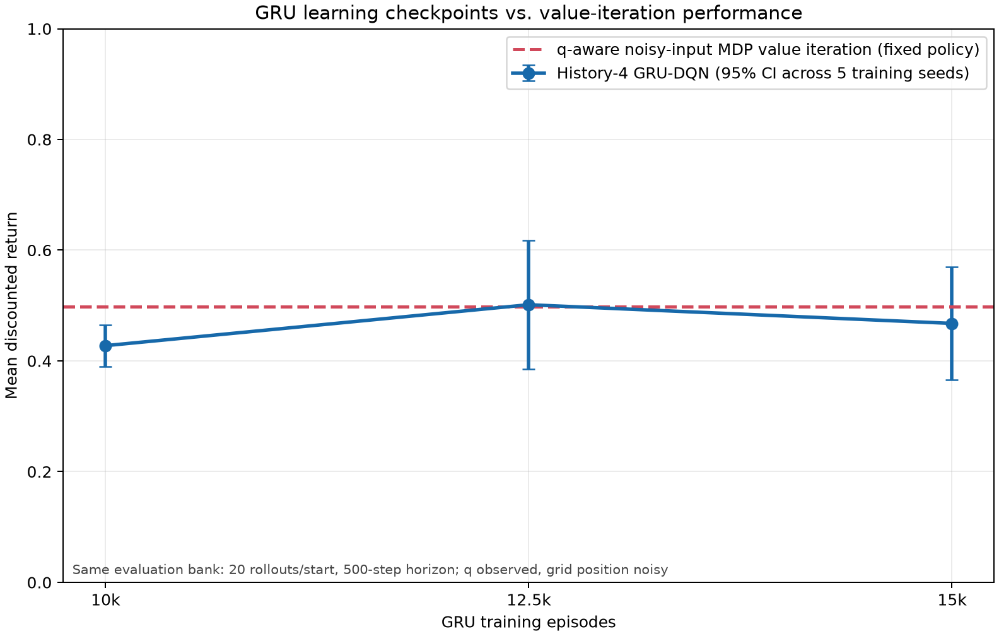

# Section One experiment protocol

The active Section One study asks whether a history-4 GRU-DQN helps under
partial grid observability and whether GRU freezing or an RSSM encoder changes
training time and convergence. Full results and the same-grid return tables
are in [RESEARCH_RESULTS_REPORT.md](RESEARCH_RESULTS_REPORT.md).

## Observation contract

All learned policies receive the current Rabin-pair index, the true task
automaton state `q`, and a noisy grid row and column. Position-observation
error is 0.25. The GRU and RSSM use four recent observations plus preceding
actions; the MLP receives only the current observation. All arms share the
same q-derived action mask. Only grid position is partially observed.

## Training settings

- One agent, `(F G a | F G b) & G !c`, 5×4 grid.
- Five matched seeds: 17–21; 15,000 episodes × 600 steps (9,000,000 steps/run).
- Batch 32; learning rate `1e-4`; replay capacity 100,000.
- Replay updates every 4 environment steps; target weights copied every 50.
- Epsilon decreases linearly from 1.0 to 0.1 over the first 25% of episodes.
- Automaton-action probability 0.2; discounts 0.99999/0.99.
- Runs were executed serially.
- Freeze arm: GRU and Q head trained jointly through 10,000 episodes; only Q
  head trained afterward.
- RSSM arm: deterministic size 16, two 4-class categorical variables, and
  auxiliary observation/reward/KL weights 0.1/0.1/0.01.

The scale loosely follows Li (2024), Chapter 4, §4.5.1, Task 1. It is adapted
to this project's task, grid, noise channel, and architectures, not reproduced.

## Results at a glance

| Comparison | Result |
|:--|:--|
| GRU vs. current-observation MLP | 0.525 vs. 0.324; paired +0.201, 95% interval [+0.076, +0.326]; GRU won 5/5 seeds |
| GRU vs. noisy-input product-MDP VI | VI 0.533; GRU−VI −0.008, 95% interval [−0.134, +0.118]; no established GRU advantage |
| Frozen vs. full GRU time | Mean observed saving 1,503 s, 95% interval [+225, +2,781] |
| Frozen vs. full GRU final quality | −0.052, 95% interval [−0.192, +0.088]; did not pass −0.05 non-inferiority margin |
| RSSM vs. full GRU time | Mean saving −326 s, 95% interval [−1,646, +994]; no reliable saving |
| RSSM vs. full GRU final quality | −0.022, 95% interval [−0.169, +0.124]; non-inferiority not established |

The full-GRU cohort ran before the frozen/RSSM cohort, and measured throughput
changed sharply during the campaign. The time differences are descriptive; a
counterbalanced timing replication is needed for a strong causal speed claim.

### GRU checkpoint returns versus value iteration



This learning-curve comparison evaluates the saved GRU policies at 10k,
12.5k, and 15k episodes. The dashed value-iteration series is one fixed
q-aware policy, not a model being trained. Both are evaluated on the same 20
rollouts per traversable start with a 500-step horizon; the value-iteration
mean on this bank is 0.4984. Regenerate the figure with
`venv/bin/python plot_gru_training_vs_value_iteration.py`.

## Reproduction

Invoke each command serially. The default checkpoint path includes architecture
and seed. Repeat the commands for seeds 17 through 21.

```sh
venv/bin/python train_pomdp.py --architecture gru \
  --reveal-automaton-state --seed 17 --episodes 15000 --horizon 600 \
  --history-length 4 --checkpoint-episodes 10000 12500

venv/bin/python train_pomdp.py --architecture mlp \
  --reveal-automaton-state --seed 17 --episodes 15000 --horizon 600

venv/bin/python train_pomdp.py --architecture gru \
  --reveal-automaton-state --seed 17 --episodes 15000 --horizon 600 \
  --history-length 4 --freeze-gru-after-episodes 10000

venv/bin/python train_pomdp.py --architecture rssm \
  --reveal-automaton-state --seed 17 --episodes 15000 --horizon 600 \
  --history-length 4 --rssm-hidden-size 16 \
  --rssm-stochastic-variables 2 --rssm-categorical-classes 4
```

For checkpoint maps, run `plot_pomdp_policy_checkpoint.py` with the checkpoint
path and an output path. Its renderer is also the visual reference used for
the policy-map gallery in the experiment record.

## Extended training and office transfer

The original 15k comparison showed a GRU advantage over the current-reading
MLP, but its 10k–15k checkpoint curve did not establish convergence. The
extended core comparison trained new matched GRU/MLP runs for 30,000 episodes
on seeds 17–19 and evaluated checkpoints at 15k, 20k, 25k, and 30k. It is
serial and uses the same q-visible inputs, task, and hyperparameters as the
main experiment. Each run contains 18,000,000 environment steps; epsilon
reaches its floor at 7,500 episodes. The 30k final evaluation used 100 paired
rollouts per start and a 1,000-step horizon. GRU mean return was 0.612 versus
0.381 for MLP, with a paired difference of +0.232 (95% interval +0.190 to
+0.273 across three training seeds). Each seed favored GRU. The 20k and 25k
budget intervals cross zero, so this establishes the comparison at 30k but
not asymptotic convergence. See [RESEARCH_RESULTS_REPORT.md](RESEARCH_RESULTS_REPORT.md)
and the local artifacts under `artifacts/section_one_long/` for the complete
tables and visuals.

The office transfer uses Junchao Li's single-agent 4×4 office layout and task
`G F (p & F (a | c)) & G !s`. Both networks receive true automaton state `q`
and the current room reading. The reading's probabilities come from the full
N/S/E/W wall signature: 11 cells are unique; the other five form alias groups
of sizes 2 and 3, sampled uniformly. No single-direction sensor is used. The
GRU receives four readings and preceding actions; the MLP receives only the
current reading. Training starts at the thesis start `(3,3)`, lasts 30,000
episodes × 300 steps, and is matched on seeds 17–19. Evaluation uses 50 paired
rollouts from each of 16 rooms, a 1,000-step horizon, and reports the thesis
start separately.

The 30k office result did not establish a GRU advantage, so all six matched
office models were trained to 60k episodes, serially, with snapshots at 30k
and 45k. The 60k cohort keeps the same 25% epsilon-decay fraction, so epsilon
reaches its 0.1 floor at 15k episodes. The 30k snapshots in this extension
therefore have a different exploration schedule from the separately trained
30k cohort. Every snapshot was evaluated on 50 paired rollouts per room, a
1,000-step horizon, and all 16 starts; `(3,3)` is also reported separately.

| Snapshot from 60k schedule | GRU − MLP return, all rooms (mean [95% CI across seeds]) | GRU − MLP safe acceptance, all rooms (mean [95% CI]) | GRU − MLP safe acceptance from `(3,3)` (mean [95% CI]) |
|---:|:--|:--|:--|
| 30,000 | −0.000277 [−0.000378, −0.000176] | −0.015 [−0.055, +0.025] | −0.060 [−0.159, +0.039] |
| 45,000 | +0.000290 [−0.002032, +0.002611] | +0.023 [−0.184, +0.230] | +0.040 [−0.270, +0.350] |
| 60,000 | −0.000107 [−0.001759, +0.001546] | −0.009 [−0.144, +0.127] | −0.067 [−0.528, +0.395] |

The 60k extension still does not establish that GRU improves office
performance. At 60k, mean all-room return was 0.00125 for GRU and 0.00135 for
MLP; safe acceptance was 0.118 and 0.126. From `(3,3)`, mean safe acceptance
was 0.133 for GRU and 0.200 for MLP. Across-seed intervals cross zero at 45k
and 60k, and seed-level effects change direction. GRU had a lower mean storage
violation rate at 60k (0.102 vs 0.164), but its across-seed interval also
includes zero. Treat this as an inconclusive transfer result, not a successful
transfer claim.

The 60k office models each used 18,000,000 environment steps. GRU training
took 4,721–4,734 seconds per seed and MLP training took 2,059–2,064 seconds.
The runs spanned 07:12–12:51 UTC on 2026-11-12 and were executed consecutively.
Their first-to-last 1,000-episode training-return means declined for every
model, which is a warning about optimization behavior but is not a substitute
for the rollout evaluation. Training curves, budget plots, and notebook-style
policy maps are under `artifacts/office_extended_60k/visualizations/`.

The office runner, evaluator, and visualizer are `train_office_pomdp.py`,
`evaluate_office_gru_vs_mlp.py`, and `plot_office_experiment.py`. The 30k run
is in `checkpoints_office_extended/` and `artifacts/office_extended/`; the
completed 60k extension is in `checkpoints_office_60k/` and
`artifacts/office_extended_60k/`. Policy maps use the existing notebook-style
grid renderer conventions.

## Completed 60k core extension

The matched q-visible history-4 GRU-DQN and current-observation MLP-DQN
extension completed serially on seeds 17–19. Each model trained for 60,000
episodes × 600 steps (36,000,000 environment steps), with checkpoints at
30k, 45k, and 60k. The GRU receives four recent observations plus preceding
actions; the MLP receives the current reading. Both observe the true task
automaton state and Rabin-pair index, while grid coordinates have 0.25
observation error. Shared settings were batch 32, learning rate 1e-4, replay
capacity 100,000, replay update every 4 environment steps, target update every
50 steps, automaton-action probability 0.2, discounts 0.99999/0.99, and linear
epsilon decay from 1.0 to 0.1 over the first 25% of episodes.

Final evaluation used 100 paired rollouts per start over 19 traversable start
cells, with a 1,000-step horizon. At 60k, mean return was 0.570 for GRU and
0.293 for MLP. The paired difference was +0.277, but its 95% interval across
training seeds was [−0.254, +0.807]. All three seed means favored GRU
(+0.034, +0.434, and +0.362), while only the 45k snapshot's across-seed
interval excluded zero in the smaller budget evaluation. This is directionally
positive evidence, but the three-seed interval does not establish a robust
advantage or convergence.

| Snapshot | Mean GRU − MLP return | 95% interval across training seeds |
|---:|---:|:--|
| 30k | +0.180 | [−0.073, +0.433] |
| 45k | +0.219 | [+0.041, +0.397] |
| 60k | +0.248 | [−0.190, +0.687] |

Runs occupied a serial wall-clock window of 16h55m, from 2026-11-12 13:04:58
to 2026-11-13 06:00:06 UTC. Per-model training times were 15,439/12,830/13,721
seconds for GRU seeds 17/18/19 (0.2573/0.2138/0.2287 s/episode) and
7,438/7,279/3,978 seconds for MLP (0.1240/0.1213/0.0663 s/episode). The exact
per-run timings, training-return summaries, launch logs, checkpoints, and
evaluation JSON are under `artifacts/section_one_long_60k/` and
`checkpoints_section_one_60k/`.

Training curves and evaluation plots are in
`figures/section_one_60k/`. The same-grid return maps use the existing
notebook-style renderer; individual seed/policy maps are available there as
well. See [RESEARCH_RESULTS_REPORT.md](RESEARCH_RESULTS_REPORT.md) for the
interpretation alongside the Office transfer and training-speed experiments.

## Historical material removed from the active tree

The older q-hidden training-length and automaton-state ablation workflows,
one-seed freeze/RSSM pilot analysis, and their stand-alone reports were
removed. The office workflow above is a new q-visible transfer experiment.
The source notebooks and core grid, LTL/LDBA, DQN, and POMDP modules remain.
