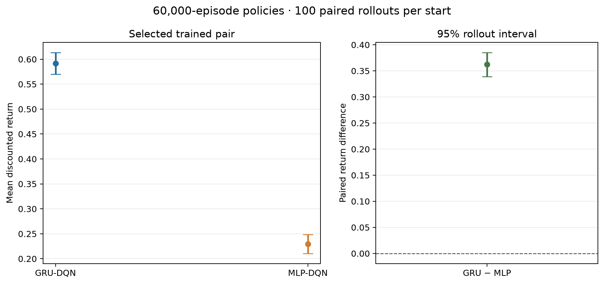
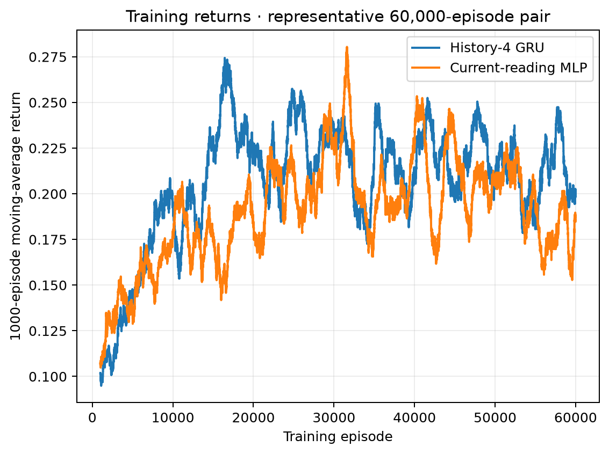

# Temporal-logic motion planning under partial observations

This repository studies recurrent Q learning for a robot that must satisfy a
long-horizon task while its grid position is uncertain. The controller sees
the true automaton state `q` and Rabin-pair index; only grid position is
partially observed.

## Experiment 1: history-4 GRU versus current-reading MLP

The longest core comparison trained for 60,000 episodes × 600 steps. The
report shows one median paired outcome from that completed comparison. In this
representative pair, the GRU return was 0.592 and the MLP return was 0.229;
the paired difference was +0.362 (95% interval across evaluation rollouts:
[+0.339, +0.385]). This interval describes rollout variability for these two
policies, not variability between training runs.

The same-grid return maps and tables use the notebook visualizer:
[GRU](figures/section_one_median/gru_returns.png) ·
[MLP](figures/section_one_median/mlp_returns.png) ·
[GRU minus MLP](figures/section_one_median/gru_minus_mlp.png) ·
[numeric grid tables](figures/section_one_median/grid_values.md).

The Office Task 1 transfer is underway as part of Experiment 1. It keeps the
existing acceptance reward and uses a longer episode horizon to increase
exposure to the sparse reward. The task is to repeatedly collect papers at
the printer, deliver them to Office `a` or `c`, and always avoid storage `S`:

\[
\Box\Diamond( Print\land\Diamond(a\lor c))\land\Box\neg S.
\]

The task and implementation-alignment recommendations are in
[RESEARCH_RESULTS_REPORT.md](RESEARCH_RESULTS_REPORT.md).

## Experiment 2: training time

The three methods are being rerun serially for 60,000 episodes × 600 steps
each, matching Experiment 1A's training budget. The previous shorter endpoint
is omitted from the current comparison. Results will be added when all three
final policies have been evaluated.

Protocol and implementation details are in
[EXPERIMENTS.md](EXPERIMENTS.md); analysis and next steps are in
[RESEARCH_RESULTS_REPORT.md](RESEARCH_RESULTS_REPORT.md).
