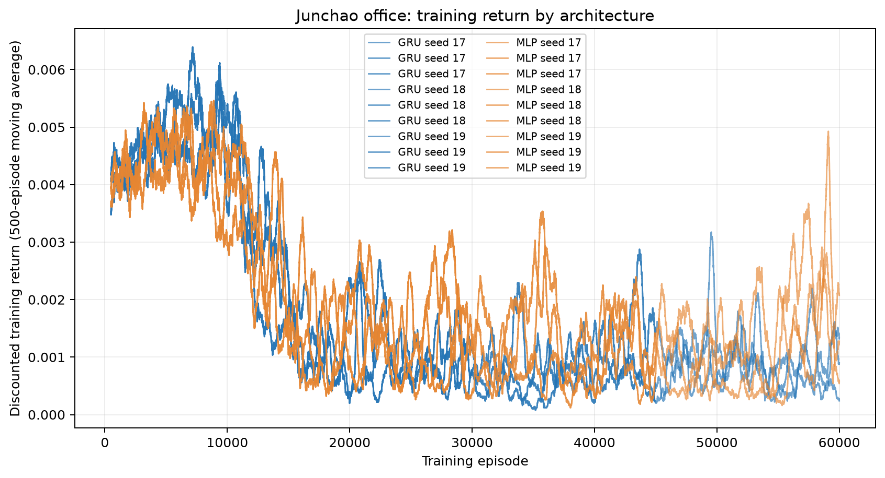
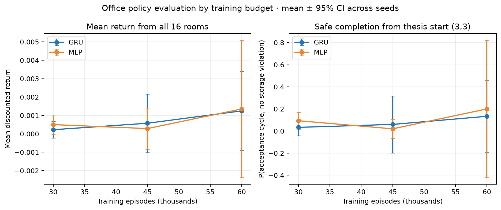
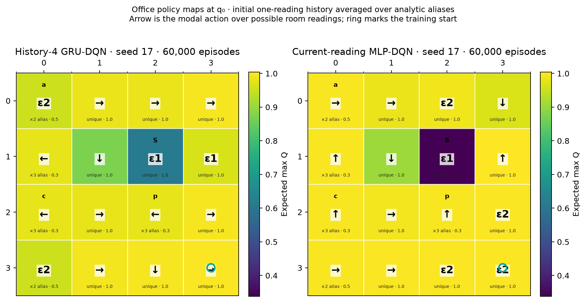
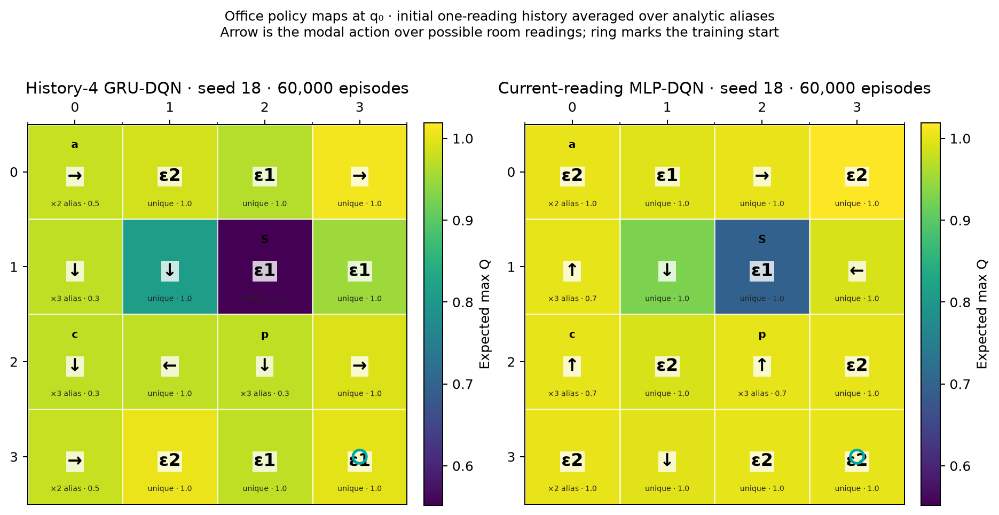
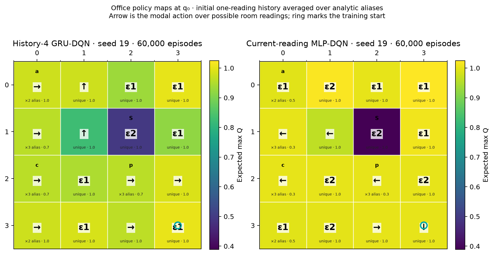

# Section One: recurrent Q learning with partial grid observability

## Research question

Can a deep recurrent Q network learn a motion-planning policy for a temporal
logic task when grid position is uncertain? Does a history-4 GRU-DQN improve
over a feedforward DQN that sees only the latest reading? Can freezing the
GRU or learning an RSSM encoder reduce training time while retaining policy
quality?

This report covers the selected Section One experiments and the longer
training and office-transfer follow-ups. The agent always receives the true
current automaton state `q`; only grid position is partially observed. The
older q-hidden and automaton-state ablation pilots are not part of these
results.

## Environment and model inputs

A single agent acts in the project 5×4 grid under `(F G a | F G b) & G !c`.
The noisy position channel has error probability 0.25. All learned policies
receive the current Rabin-pair index, true automaton state `q`, and noisy row
and column. They share a q-derived legal-action mask; none receives true grid
coordinates, hidden labels, or a hidden product state.

The GRU receives the latest four observations and preceding actions. It has one
64-unit recurrent layer, 17,608 total parameters, including a 520-parameter Q
head. The feedforward comparison is a two-hidden-layer, 64-unit MLP with
5,640 parameters. The MLP receives only the current observation. The compact
RSSM has a 16-unit deterministic state and two 4-class categorical variables,
with 3,111 total parameters. Its auxiliary observation, reward, and KL loss
weights are 0.1, 0.1, and 0.01; its encoder is trained jointly with the DQN.
The frozen-GRU arm updates the GRU and Q head through episode 10,000, then
freezes the GRU and updates only the Q head.

The experiment scale follows Li (2024), Chapter 4, §4.5.1, Task 1, loosely:
the task and 15,000 × 600 training budget are similar, while the environment,
observation channel, four-step history, GRU/RSSM architecture, and other
settings remain those of this project. This is not a reproduction of the
thesis. [Thesis record](https://doi.org/10.25820/etd.007512).

## Shared training protocol

| Setting | Value |
|:--|:--|
| Training seeds | 17, 18, 19, 20, 21 |
| Episodes × maximum steps | 15,000 × 600 per run |
| Environment steps | 9,000,000 per run |
| Batch size | 32 |
| Optimizer learning rate | 1e-4 |
| Replay capacity | 100,000 |
| Replay update interval | Every 4 environment steps |
| Target network update | Every 50 environment steps |
| Exploration | Linear 1.0 → 0.1 over first 25% of episodes, then 0.1 |
| Automaton action probability | 0.2 |
| Discounts | 0.99999 nonaccepting; 0.99 accepting |
| Execution | Serial, one training process at a time |

Across-seed confidence intervals use the five training seeds as independent
replicates. Rollouts within a trained policy are paired samples, not additional
training seeds.

## Experiment 1: history-4 GRU versus current-observation MLP

Each model was evaluated greedily from all 19 traversable starts, using 100
common rollouts per start and a 1,000-step horizon. Mean discounted return:

| Policy | Mean | 95% interval across training seeds |
|:--|--:|:--:|
| History-4 GRU-DQN | 0.5250 | [0.3991, 0.6509] |
| Current-observation MLP-DQN | 0.3236 | [0.2196, 0.4276] |
| Paired GRU − MLP | **+0.2014** | **[+0.0763, +0.3265]** |

| Training seed | GRU return | MLP return | GRU − MLP |
|---:|---:|---:|---:|
| 17 | 0.4845 | 0.2105 | +0.2739 |
| 18 | 0.5115 | 0.2890 | +0.2225 |
| 19 | 0.6612 | 0.3517 | +0.3095 |
| 20 | 0.3907 | 0.3279 | +0.0628 |
| 21 | 0.5771 | 0.4389 | +0.1382 |

The GRU won on all five seeds, and the paired interval is positive. This
supports the claim that observation history and recurrence help over the
matched current-observation DQN in this task, with `q` visible to both models.

### Same-grid per-start empirical returns

The entries in each cell are ordered **GRU / MLP / frozen GRU / RSSM / noisy
input VI**. They are empirical discounted returns from that start, not a
learned scalar state-value function. `B` is a wall, `T` marks a trap, and the
letters are proposition labels.

| Row / column | 0 | 1 | 2 | 3 |
|:--|:--|:--|:--|:--|
| 0 | 0.30 / 0.25 / 0.15 / 0.27 / 0.60 | 0.27 / 0.24 / 0.12 / 0.25 / 0.59 | c · 0.00 / 0.00 / 0.00 / 0.00 / 0.00 | 0.78 / 0.17 / 0.80 / 0.74 / 0.29 |
| 1 | 0.35 / 0.28 / 0.12 / 0.28 / 0.63 | 0.35 / 0.31 / 0.17 / 0.28 / 0.54 | a · 0.51 / 0.18 / 0.36 / 0.30 / 0.64 | b/T · 1.00 / 1.00 / 1.00 / 1.00 / 1.00 |
| 2 | B | 0.49 / 0.36 / 0.21 / 0.41 / 0.62 | c · 0.00 / 0.00 / 0.00 / 0.00 / 0.00 | 0.82 / 0.42 / 0.83 / 0.83 / 0.64 |
| 3 | b/T · 1.00 / 0.80 / 1.00 / 1.00 / 1.00 | 0.62 / 0.53 / 0.73 / 0.63 / 0.50 | a/T · 1.00 / 1.00 / 1.00 / 1.00 / 1.00 | 0.88 / 0.60 / 0.85 / 0.93 / 0.71 |
| 4 | 0.88 / 0.00 / 0.88 / 0.86 / 0.63 | c · 0.00 / 0.00 / 0.00 / 0.00 / 0.00 | 0.74 / 0.00 / 0.76 / 0.77 / 0.74 | c · 0.00 / 0.00 / 0.00 / 0.00 / 0.00 |

The corresponding notebook-style maps for each policy, VI, and the paired
differences are retained as local experiment outputs; the numeric table above
is included directly so the repository documentation remains self-contained.

### Ordinary MDP value-iteration reference

We evaluated product-MDP value iteration with true `q`, but supplied noisy row
and column as if they were the current grid state. This is a regular MDP policy
indexed by a noisy state reading, not a belief-state POMDP solver. Its mean
return was 0.5331. The paired GRU-minus-VI difference was −0.0081 (95%
interval −0.1340 to +0.1178); GRU was higher on two of five seeds. The study
does not establish GRU superiority over value iteration.

The checkpoint learning curve uses a shorter, matched evaluation protocol:
20 rollouts per start and a 500-step horizon. On that bank, noisy-input VI
returned 0.4984. The graph shows GRU checkpoint performance against this fixed
VI reference; the VI line is not a training trajectory.

## Experiment 2: training time and convergence

The full-GRU arm reuses Experiment 1 checkpoints. The frozen-GRU and RSSM
arms were trained on the same five seeds and budgets. Policies were evaluated
at 10,000, 12,500, and 15,000 episodes using 20 common rollouts per start and
a 500-step horizon. Final policies were evaluated again using 100 rollouts
per start and a 1,000-step horizon. The quality-preservation margin was −0.05
return points; its paired 95% interval had to lie above −0.05 to support a
faster-at-comparable-quality claim.

### Final quality and measured training time

| Policy | Mean return | Difference vs full GRU (95% interval) | Mean training-loop seconds |
|:--|--:|:--:|--:|
| Full GRU | 0.5250 | reference | 3,651 |
| Frozen after 10k | 0.4733 | −0.0517 [−0.1919, +0.0885] | 2,148 |
| RSSM encoder | 0.5028 | −0.0222 [−0.1687, +0.1244] | 3,977 |

Freezing saved a paired mean of 1,503 training-loop seconds (95% interval
+225 to +2,781). Its final quality interval did not pass the −0.05 margin.
RSSM's paired time saving was −326 seconds (95% interval −1,646 to +994),
and its quality interval also did not establish non-inferiority. Therefore,
freezing reduced observed time in this campaign, but no method was shown to
train faster at comparable final quality.

### Checkpoint convergence

| Episodes | Full GRU return (95% interval) | Frozen GRU return (95% interval) | RSSM return (95% interval) |
|---:|:--:|:--:|:--:|
| 10,000 | 0.428 [0.390, 0.465] | 0.428 [0.390, 0.465] | 0.469 [0.320, 0.619] |
| 12,500 | 0.501 [0.385, 0.618] | 0.447 [0.392, 0.503] | 0.426 [0.330, 0.521] |
| 15,000 | 0.468 [0.366, 0.570] | 0.440 [0.407, 0.472] | 0.464 [0.349, 0.580] |

The frozen 10k checkpoint is the same weights as the full GRU 10k checkpoint.
At 15k, paired 20-rollout differences versus full GRU were −0.0279 (95%
interval −0.1318 to +0.0760) for frozen and −0.0034 (−0.0990 to +0.0921)
for RSSM. Using the descriptive rule “first saved checkpoint reaching 90%
of that seed's full-GRU 15k return,” frozen reached the threshold in 3/5
seeds at mean 1,552 seconds; RSSM in 4/5 at mean 2,609 seconds. This is coarse
because checkpoints were saved at only three budgets.

## Training wall-clock record

Each successful run used 15,000 episodes. Process wall time divided by 15,000
gives the seconds/episode values below. The trainer's loop timer differs from
process time by only a few seconds per run.

| Seed | Full GRU seconds (s/episode) | Frozen seconds (s/episode) | RSSM seconds (s/episode) |
|---:|---:|---:|---:|
| 17 | 4,402.9 (0.2935) | 2,104.5 (0.1403) | 3,959.9 (0.2640) |
| 18 | 4,424.1 (0.2949) | 2,268.0 (0.1512) | 3,937.5 (0.2625) |
| 19 | 4,418.5 (0.2946) | 2,128.6 (0.1419) | 4,014.6 (0.2676) |
| 20 | 2,716.8 (0.1811) | 2,127.5 (0.1418) | 3,991.1 (0.2661) |
| 21 | 2,308.0 (0.1539) | 2,123.8 (0.1416) | 3,990.7 (0.2660) |
| **Mean** | **3,654.1 (0.2436)** | **2,150.5 (0.1434)** | **3,978.8 (0.2653)** |

Full-GRU throughput changed sharply: seeds 17–19 took about 4,400 seconds,
while seeds 20–21 took 2,717 and 2,308 seconds. Full-GRU runs preceded all
frozen/RSSM runs. Time-dependent machine load or throughput therefore
confounds the apparent speed difference. The measured timings are retained,
but a counterbalanced timing replication is needed for a strong causal claim.

Training used CPU on macOS 26.6.2, arm64 Apple Silicon, Python 3.14.2,
PyTorch 2.14.0, and NumPy 2.5.2. Successful training ran serially from
2026-11-10 20:15 UTC through 2026-11-11 12:11 UTC. Two early seed-17 GRU
attempts were excluded: one stopped during protocol review after 793.9 seconds;
a second stopped on a zero-length commitment tensor bug after 2.8 seconds,
before saving a checkpoint.

| Evaluation job | UTC start | UTC finish | Wall seconds |
|:--|:--|:--|--:|
| GRU vs MLP | 2026-11-11 12:12 | 2026-11-11 12:29 | 1,013.5 |
| Checkpoint convergence | 2026-11-11 12:29 | 2026-11-11 12:41 | 726.6 |
| Final quality and VI | 2026-11-11 12:41 | 2026-11-11 13:24 | 2,582.1 |
| Policy-map generation | 2026-11-11 13:24 | 2026-11-11 13:24 | 22.4 |

## Longer-training follow-up: core task

The original 15k campaign showed a GRU advantage but did not establish that
performance had stabilized. New matched runs used seeds 17–19 and doubled the
budget to 30,000 episodes × 600 steps (18,000,000 environment steps per run).
The task, q-visible input contract, model sizes, and optimizer settings were
unchanged. Runs were serial. Each run saved policy snapshots at 15k, 20k, 25k,
and 30k episodes.

The 30k final evaluation used 100 common rollouts per start cell, all 19
traversable starts, and a 1,000-step horizon:

| Policy | Mean return across seeds | 95% interval across training seeds |
|:--|--:|:--:|
| History-4 GRU-DQN | 0.6125 | [0.5626, 0.6623] |
| Current-observation MLP-DQN | 0.3807 | [0.3282, 0.4332] |
| Paired GRU − MLP | **+0.2318** | **[+0.1903, +0.2732]** |

The GRU-minus-MLP gap was positive on each seed: +0.2464 (seed 17), +0.2136
(seed 18), and +0.2353 (seed 19). This is clear evidence for the GRU at the
30k budget on this task. It does not show asymptotic convergence: the 20k and
25k checkpoint intervals across seeds include zero, and the training-return
curves still fluctuate.

| Checkpoint budget | GRU mean return | MLP mean return | Paired GRU − MLP (95% interval across seeds) |
|---:|---:|---:|:--|
| 15,000 | 0.4807 | 0.3107 | +0.1699 [+0.0069, +0.3329] |
| 20,000 | 0.4517 | 0.3163 | +0.1355 [−0.1078, +0.3787] |
| 25,000 | 0.4541 | 0.3206 | +0.1336 [−0.0999, +0.3671] |
| 30,000 | 0.5650 | 0.3819 | +0.1831 [+0.1500, +0.2161] |

These checkpoint results use 20 rollouts per start and a 500-step horizon.
The final 30k evaluation above is a separate, larger 100-rollout evaluation
with a 1,000-step horizon. The GRU took 8,767–8,957 seconds per 30k run
(mean 8,859 seconds, about 2 h 28 min); the MLP took 2,957–3,797 seconds
(mean 3,512 seconds, about 58 min). Exact per-seed timings and start/finish
times are recorded in checkpoint sidecars under
`checkpoints_section_one_long/`.

## Junchao Li office transfer: 30k-episode result

The office experiment uses Li's single-agent 4×4 office layout, the task
`G F (p & F (a | c)) & G !s`, and his thesis start `(3,3)`. The model input
includes the true automaton state `q`; only the physical room reading is
partial. The observation channel is derived from the complete N/S/E/W wall
signature. Eleven rooms have unique signatures. The five ambiguous rooms
belong to two alias groups: `(0,0)` and `(3,0)` have probability 1/2 each;
`(1,0)`, `(2,0)`, and `(2,2)` have probability 1/3 each. No single-direction
sensor is used.

Three matched seeds trained for 30,000 episodes × 300 steps (9,000,000
environment steps per model). Training started at `(3,3)`, used the same
hyperparameters as the core extension, and ran serially. Evaluation used 50
paired rollouts per room, a 1,000-step horizon, all 16 possible starts, and a
separate summary for `(3,3)`.

| Seed | GRU wall seconds | MLP wall seconds | GRU UTC start → finish | MLP UTC start → finish |
|---:|---:|---:|:--|:--|
| 17 | 2,348.0 (0.0783 s/episode) | 1,022.8 (0.0341 s/episode) | 04:05:09 → 04:44:17 | 04:44:19 → 05:01:21 |
| 18 | 2,348.1 (0.0783 s/episode) | 1,024.3 (0.0341 s/episode) | 05:01:23 → 05:40:31 | 05:40:33 → 05:57:37 |
| 19 | 2,340.9 (0.0780 s/episode) | 1,025.6 (0.0342 s/episode) | 05:57:38 → 06:36:39 | 06:36:41 → 06:53:46 |

All timestamps are 2026-11-12 UTC. The six runs together spanned 04:05–06:53
UTC and were executed consecutively.

| Budget | GRU − MLP return, all rooms (95% interval across seeds) | GRU − MLP safe acceptance, all rooms (95% interval) | GRU − MLP return from `(3,3)` (95% interval) | GRU − MLP safe acceptance from `(3,3)` (95% interval) |
|---:|:--|:--|:--|:--|
| 15,000 | +0.00033 [−0.00070, +0.00135] | +0.024 [−0.053, +0.101] | −0.00232 [−0.00486, +0.00022] | −0.213 [−0.458, +0.032] |
| 20,000 | +0.00164 [−0.00271, +0.00600] | +0.109 [−0.176, +0.394] | +0.00119 [−0.00607, +0.00845] | +0.087 [−0.502, +0.675] |
| 25,000 | +0.00071 [−0.00483, +0.00626] | +0.108 [−0.137, +0.353] | −0.00157 [−0.01053, +0.00739] | −0.013 [−0.390, +0.363] |
| 30,000 | +0.00016 [−0.00604, +0.00636] | +0.018 [−0.516, +0.552] | −0.00133 [−0.00926, +0.00661] | −0.120 [−0.816, +0.576] |

The office results do not establish a GRU advantage. Across all rooms at 30k,
mean return was 0.00171 for GRU and 0.00155 for MLP, while safe acceptance
was 0.155 versus 0.137. From the thesis start `(3,3)`, mean safe acceptance
was 0.10 for GRU and 0.22 for MLP. Training-seed intervals are wide and cross
zero for every budget. Per-seed results also change direction: at 30k, seeds
17 and 19 favor GRU in all-room return, while seed 18 favors MLP. The office
training-return curves are non-monotonic and generally end below their
first-1,000-episode means.

This is an inconclusive transfer result, not evidence that transfer has been
demonstrated. We therefore ran a matched 60k-episode extension on seeds
17–19, serially, and evaluated its 30k, 45k, and 60k snapshots. This extension
keeps the 25% epsilon-decay fraction, so epsilon reaches its floor at 15k.
Its 30k snapshot has a different exploration schedule than the separately
trained 30k cohort above; the cohorts are reported separately.

| Snapshot from 60k schedule | GRU − MLP return, all rooms (mean [95% CI across three seeds]) | GRU − MLP safe acceptance, all rooms (mean [95% CI]) | GRU − MLP safe acceptance from `(3,3)` (mean [95% CI]) |
|---:|:--|:--|:--|
| 30,000 | −0.000277 [−0.000378, −0.000176] | −0.015 [−0.055, +0.025] | −0.060 [−0.159, +0.039] |
| 45,000 | +0.000290 [−0.002032, +0.002611] | +0.023 [−0.184, +0.230] | +0.040 [−0.270, +0.350] |
| 60,000 | −0.000107 [−0.001759, +0.001546] | −0.009 [−0.144, +0.127] | −0.067 [−0.528, +0.395] |

At 60k, the all-room mean return was 0.00125 for GRU and 0.00135 for MLP;
safe acceptance was 0.118 and 0.126. From the thesis start `(3,3)`, mean safe
acceptance was 0.133 for GRU and 0.200 for MLP. Training-seed intervals cross
zero for return and safe acceptance at 45k and 60k, and individual seed
effects change direction. The 60k GRU's mean storage-violation rate was lower
(0.102 vs 0.164), but its across-seed interval also crosses zero. The longer
training does not establish an office GRU advantage or successful transfer.

Each 60k model used 18,000,000 environment steps. Runs were consecutive from
07:12:02 to 12:51:31 UTC on 2026-11-12. GRU training took 4,721–4,734 seconds
per seed; MLP training took 2,059–2,064 seconds. First- and last-1,000-episode
return means were:

| Seed | GRU first → last 1k | MLP first → last 1k | GRU seconds | MLP seconds | Training UTC windows (GRU; MLP) |
|---:|:--|:--|---:|---:|:--|
| 17 | 0.00430 → 0.00117 | 0.00407 → 0.00168 | 4,721.0 (0.0787 s/ep) | 2,059.1 (0.0343 s/ep) | 07:12:02–08:30:43; 08:30:44–09:05:03 |
| 18 | 0.00383 → 0.00036 | 0.00400 → 0.00093 | 4,721.9 (0.0787 s/ep) | 2,062.3 (0.0344 s/ep) | 09:05:05–10:23:47; 10:23:48–10:58:11 |
| 19 | 0.00405 → 0.00137 | 0.00386 → 0.00121 | 4,734.0 (0.0789 s/ep) | 2,063.5 (0.0344 s/ep) | 10:58:12–12:17:06; 12:17:08–12:51:31 |

The 60k office evaluation used 50 paired rollouts per room and a 1,000-step
horizon. Evaluating all nine seed-budget pairs took about 11 minutes 34
seconds, from 12:51:32 to 13:03:06 UTC. The diagnostic training curves mostly
decline, so further episodes alone may not resolve the office result without
also investigating optimization and task learning. The data and visualizations
are under `artifacts/office_extended_60k/`.

The 60k office policy maps for each seed are in
`figures/office_60k/`; 30k policy maps remain in
`artifacts/office_extended/visualizations/`.

| Training seed | Notebook-style final policy maps |
|---:|:--:|
| 17 |  |
| 18 |  |
| 19 |  |

## 60k core extension: longer training

Because the 30k core comparison had not established convergence, we trained
new matched history-4 GRU-DQN and current-observation MLP-DQN models for
60,000 episodes on seeds 17–19. Every model used 600 steps per episode
(36,000,000 environment steps), and checkpoints were evaluated at 30k, 45k,
and 60k. Runs were serial and used the same task and observation contract:
true automaton state `q` and Rabin-pair index are inputs to both policies,
while grid position has 0.25 observation error. The GRU observes four recent
observations and preceding actions; the feedforward MLP observes only the
current reading.

Hyperparameters were batch size 32, learning rate 1e-4, replay capacity
100,000, replay update every four environment steps, target update every 50
steps, automaton-action probability 0.2, discounts 0.99999/0.99, and epsilon
1.0→0.1 linearly over the first 25% of episodes, then fixed at 0.1. Final
evaluation used 100 paired rollouts per start over the 19 traversable start
cells, with a 1,000-step horizon.

| Evaluation | Mean GRU return | Mean MLP return | Paired GRU − MLP | 95% interval across training seeds |
|:--|--:|--:|--:|:--|
| 60k final, 100 rollouts/start | 0.570 | 0.293 | +0.277 | [−0.254, +0.807] |

All three seed means favor GRU: +0.034 for seed 17, +0.434 for seed 18, and
+0.362 for seed 19. Their paired rollout intervals each exclude zero, but the
across-training-seed interval is the relevant measure of variability across
independent training runs and remains wide. With only three seeds, this
follow-up is directionally positive but does not establish a seed-robust GRU
advantage.

The smaller budget evaluation used 20 paired rollouts per start and a
500-step horizon:

| Checkpoint | Mean GRU − MLP return | 95% interval across training seeds |
|---:|---:|:--|
| 30k | +0.180 | [−0.073, +0.433] |
| 45k | +0.219 | [+0.041, +0.397] |
| 60k | +0.248 | [−0.190, +0.687] |

Only the 45k snapshot's interval excludes zero. These are evaluations of
snapshots from the same 60k training runs, so they are correlated with one
another; they should not be read as three independent replications. The
longer budget and final evaluation therefore do not establish convergence.

Training ran serially from 2026-11-12 13:04:58 to 2026-11-13 06:00:06 UTC, a
16h55m wall-clock window. Each model's training loop time, mean return, and
first/last 1,000-episode return means were:

| Seed | Policy | Training seconds | Seconds/episode | Mean return | First → last 1k mean return |
|---:|:--|---:|---:|---:|:--|
| 17 | GRU | 15,439.0 | 0.2573 | 0.1956 | 0.1049 → 0.1896 |
| 17 | MLP | 7,438.4 | 0.1240 | 0.2061 | 0.1009 → 0.2336 |
| 18 | GRU | 12,829.6 | 0.2138 | 0.2134 | 0.1288 → 0.2484 |
| 18 | MLP | 7,279.1 | 0.1213 | 0.2100 | 0.1119 → 0.2126 |
| 19 | GRU | 13,721.1 | 0.2287 | 0.2062 | 0.1019 → 0.1986 |
| 19 | MLP | 3,977.9 | 0.0663 | 0.1899 | 0.1068 → 0.1857 |

The six per-run UTC windows and full metadata are in
`artifacts/section_one_long_60k/run_record.json` and checkpoint sidecars.
The budget and final evaluations are in `budget_evaluation.json` and
`final_evaluation.json` in that same directory. The initial launcher attempt
failed because system Python lacked NumPy; all six actual runs completed with
the project environment. A post-training launcher summary also failed to
import PyTorch under system Python, after training and evaluations were
complete; this did not affect the saved results.

The existing notebook-style grid renderer was used for aggregate and
per-policy empirical return maps. Each cell shows a start cell's empirical
discounted return; task labels and wall structure are drawn by the original
`GridMDP.plot` renderer.

| Training seed | History-4 GRU-DQN | Current-observation MLP-DQN |
|---:|:--:|:--:|
| 17 |  |  |
| 18 |  |  |
| 19 |  |  |

The separate [visualization index](figures/section_one_60k/README.md) also
contains aggregate GRU and MLP maps, the paired difference map, and the
training and evaluation figures.

## Current conclusion

With true `q` and noisy grid coordinates, the 30k history-4 GRU-DQN
outperformed the matched current-observation MLP on all three extended seeds.
This strengthens the core recurrence result, while the 20k/25k intervals and
training curves show that convergence is not established. The GRU still did
not establish an advantage over q-aware noisy-input value iteration. Freezing
reduced measured training time, but final quality preservation remains
inconclusive and timing is confounded by run order. RSSM showed neither a
reliable time saving nor established quality non-inferiority. The 30k office
transfer does not show a consistent GRU benefit after extending to 60k
episodes, so no positive office-transfer claim is made. The matched 60k core
extension also leans toward GRU on each of three seeds, but its across-seed
interval includes zero and does not establish a robust advantage or
convergence. All planned training and evaluation runs are complete; the full
core extension record is under `artifacts/section_one_long_60k/`.
