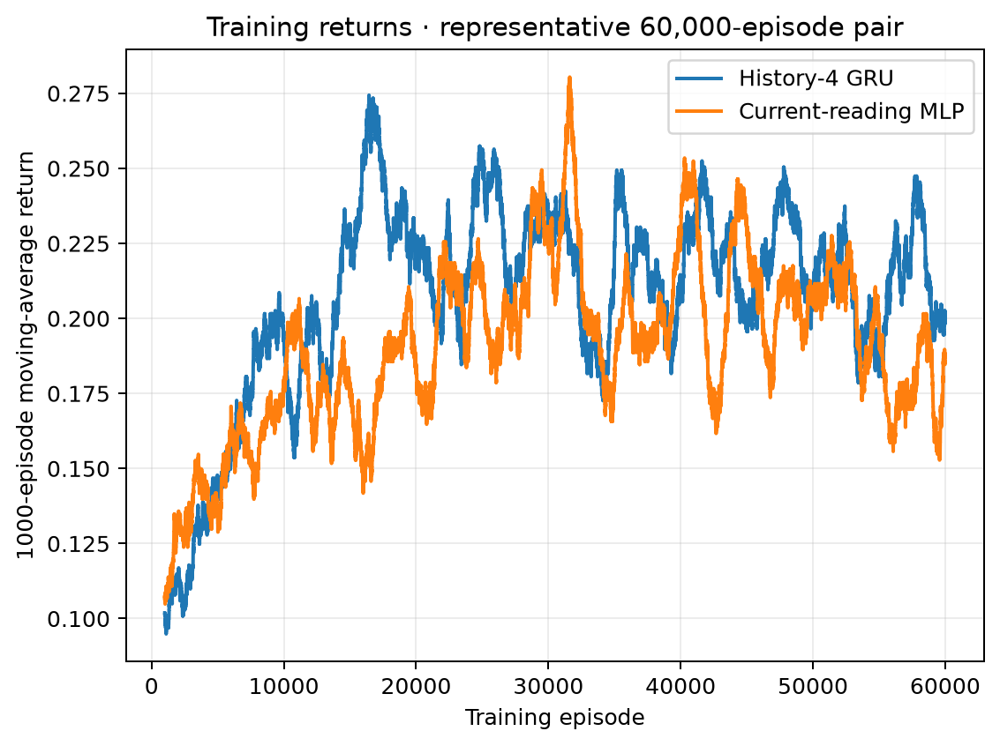
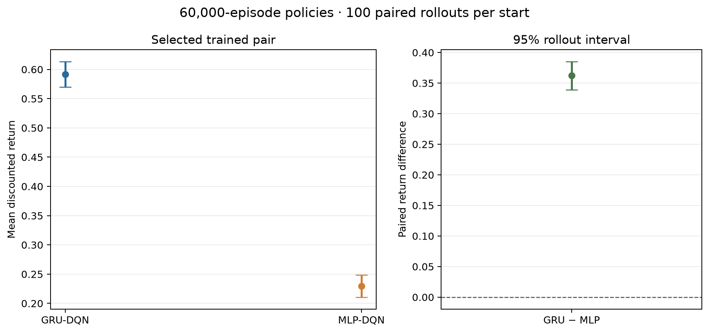
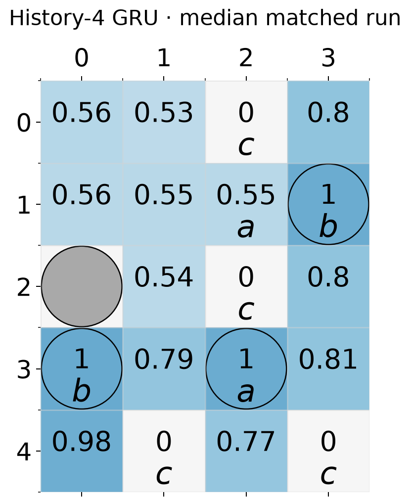
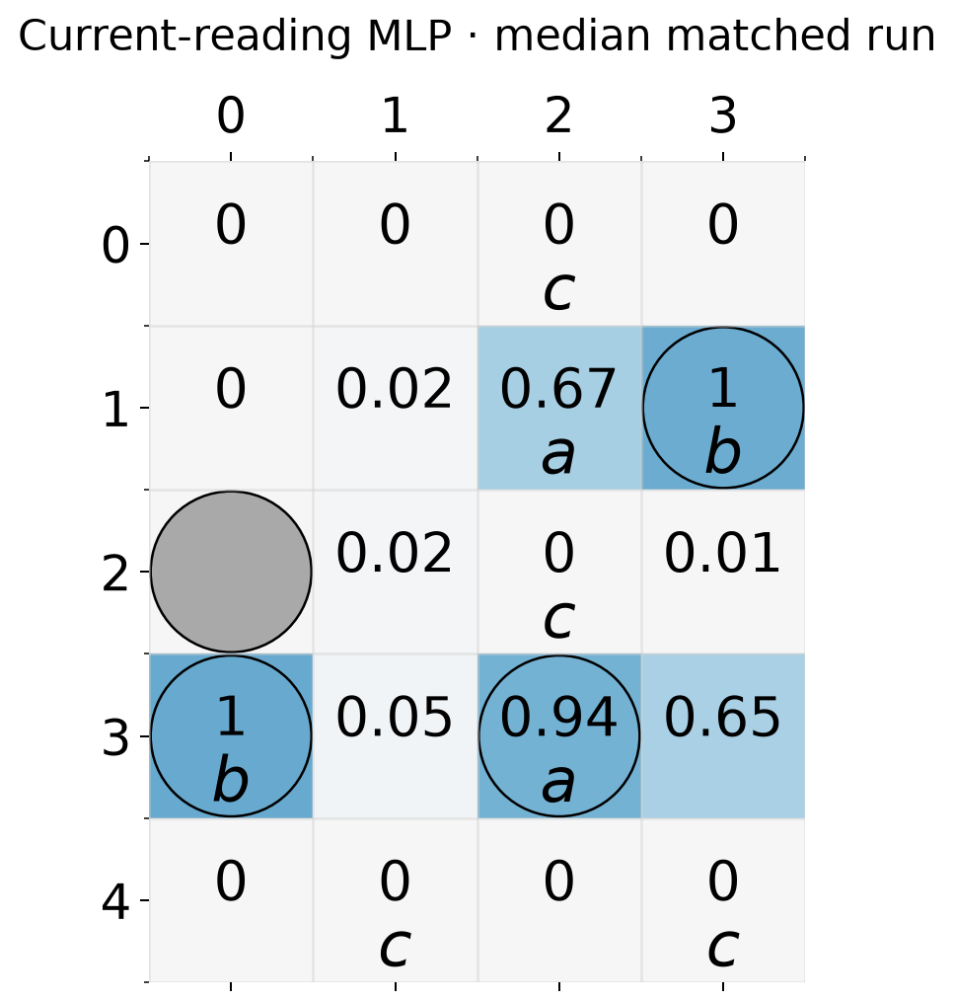
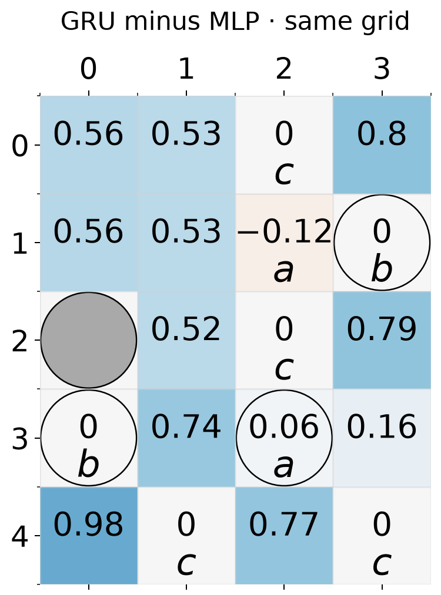

# Research results

## Scope

The q-visible study asks whether recurrent state helps temporal-logic motion
planning when only grid position is partially observable. The controller
receives the true automaton state `q` and Rabin-pair index. The core task is
`(F G a | F G b) & G !c` on the 5×4 grid, with grid observation error 0.25.

This report keeps one representative median outcome for each comparison. The
reported rollout intervals describe stochastic evaluation of those selected
policies; they do not measure variability between independent training runs.

## Experiment 1A: core GRU versus current-reading MLP

The selected matched pair comes from the longest completed budget of 60,000
episodes × 600 steps. Its paired return difference is the median among the
completed longest-budget paired outcomes. The GRU receives four recent
observations with preceding actions. The MLP sees only the latest reading.
Both receive `q`, the Rabin-pair index, and the same legal-action mask.

| Policy | Mean discounted return | 95% rollout interval |
|:--|--:|:--|
| History-4 GRU-DQN | 0.592 | [0.570, 0.613] |
| Current-reading MLP-DQN | 0.229 | [0.211, 0.248] |
| Paired GRU − MLP | **+0.362** | **[+0.339, +0.385]** |

Each policy was evaluated with 100 paired rollouts from each of 19 traversable
starts and a 1,000-step horizon. The positive paired difference is clear for
this selected pair. Since only one representative training result is shown,
it does not establish how reliably the advantage repeats across training.

### Returns on the task grid

These tables show empirical discounted return from each starting cell. They
are policy evaluation values, not the networks' internal scalar value
functions. `B` is the wall; `T` marks a trap; proposition labels are shown in
the corresponding cells.

**History-4 GRU**

| Row / column | 0 | 1 | 2 | 3 |
|:--|--:|--:|:--|--:|
| 0 | 0.563 | 0.530 | c · 0.000 | 0.800 |
| 1 | 0.558 | 0.548 | a · 0.553 | b/T · 1.000 |
| 2 | B | 0.541 | c · 0.000 | 0.800 |
| 3 | b/T · 1.000 | 0.790 | a/T · 1.000 | 0.810 |
| 4 | 0.980 | c · 0.000 | 0.770 | c · 0.000 |

**Current-reading MLP**

| Row / column | 0 | 1 | 2 | 3 |
|:--|--:|--:|:--|--:|
| 0 | 0.000 | 0.000 | c · 0.000 | 0.000 |
| 1 | 0.000 | 0.020 | a · 0.670 | b/T · 1.000 |
| 2 | B | 0.020 | c · 0.000 | 0.010 |
| 3 | b/T · 1.000 | 0.050 | a/T · 0.940 | 0.650 |
| 4 | 0.000 | c · 0.000 | 0.000 | c · 0.000 |

**Paired GRU minus MLP**

| Row / column | 0 | 1 | 2 | 3 |
|:--|--:|--:|:--|--:|
| 0 | +0.563 | +0.530 | c · 0.000 | +0.800 |
| 1 | +0.558 | +0.528 | a · −0.117 | b/T · 0.000 |
| 2 | B | +0.521 | c · 0.000 | +0.790 |
| 3 | b/T · 0.000 | +0.740 | a/T · +0.060 | +0.160 |
| 4 | +0.980 | c · 0.000 | +0.770 | c · 0.000 |

The existing notebook `GridMDP.plot` renderer generated all three grids.
Full precision data and the same-grid tables are in
[grid_values.md](figures/section_one_median/grid_values.md).

### Training cost for the selected pair

Both models trained serially for the same 60,000 × 600 budget. The elapsed
wall time was about 3 h 49 min for the GRU (13,742 s; 0.229 s/episode) and 1 h
7 min for the MLP (4,021 s; 0.067 s/episode). These times describe this
training pair and this machine.

## Experiment 1B: Office Task 1 transfer

The Office transfer is the second part of Experiment 1. Training is underway
for 60,000 episodes × 600 steps per episode. The task from Li's thesis,
§4.5.2, Task 1, requires the robot to repeatedly collect documents at the
printer, deliver them to Office `a` or `c`, and always avoid storage `S`:

\[
\varphi_{office}=\Box\Diamond( Print\land\Diamond(a\lor c))\land\Box\neg S.
\]

The local observation model uses the full north/south/east/west wall,
hallway, door, and window signatures. Identical signatures alias rooms
uniformly. The true `q` remains visible. Both the history-4 GRU and
current-reading MLP keep the grounded accepting-state reward, 0.01 for
accepting discount 0.99, with nonaccepting discount 0.99999. The target
clamp remains `[0,1]`. The longer episode horizon increases the number of
environment steps per episode without changing the task reward.

The observation and transition rules were checked against [Junchao's SARSOP
Office model and output matrices](https://github.com/JunchaoLi001/LDGBA-Model_Checking/tree/main/Office%20Simulation/Office%20full%20obsv%20by%20SARSOP).
Evaluation measures completed printer-to-office cycles, safe two-cycle
success from the training start, storage violations, and return. If the
longer run still fails to learn, the next training changes to consider are
recurrent sequence replay with burn-in and priority sampling for rare
accepting transitions.

Li's thesis [§4.5.2, Task 1](https://doi.org/10.25820/etd.007512) defines the
task and reward structure in equations (47)–(48). The SARSOP result is a
model-based policy example, not a DQN convergence curve.

## Experiment 2: GRU freeze and RSSM encoder training time

This comparison is being rerun for 60,000 episodes × 600 steps per method,
matching Experiment 1A. The full GRU trains throughout, the frozen arm stops
updating the GRU after episode 10,000, and the RSSM encoder trains jointly
with its DQN head. The three runs execute serially, with one fixed training
run per method. Only final endpoints will be retained; intermediate budgets
are omitted.

The rerun is underway. Final returns, trainer time, same-grid policy maps,
and training curves will be added after all three endpoint evaluations are
complete. This single-run comparison is descriptive and does not estimate
training-run variability.
