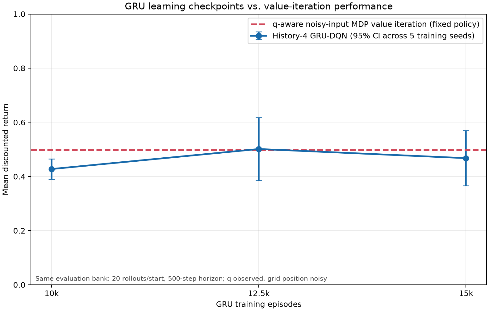

# Section One: recurrent Q learning with partial grid observability

## Research question

Can a deep recurrent Q network learn a motion-planning policy for a temporal
logic task when grid position is uncertain? Does a history-4 GRU-DQN improve
over a feedforward DQN that sees only the latest reading? Can freezing the
GRU or learning an RSSM encoder reduce training time while retaining policy
quality?

This report covers the two experiment sets selected for Section One. The agent
always receives the true current automaton state `q`; only grid position is
partially observed. Older office-transfer, training-length, q-ablation, and
q-hidden pilot workflows were removed from this repository and are not part
of these results.

## Environment and model inputs

A single agent acts in the project 5×4 grid under `(F G a | F G b) & G !c`.
The noisy position channel has error probability 0.25. All learned policies
receive the current Rabin-pair index, true automaton state `q`, and noisy row
and column. They share a q-derived legal-action mask; none receives true grid
coordinates, hidden labels, or a hidden product state.

The GRU receives the latest four observations and preceding actions. It has one
64-unit recurrent layer, 17,608 total parameters, including a 520-parameter Q
head. The feedforward comparison is a two-hidden-layer, 64-unit MLP with
5,640 parameters. The MLP receives only the current observation. The compact
RSSM has a 16-unit deterministic state and two 4-class categorical variables,
with 3,111 total parameters. Its auxiliary observation, reward, and KL loss
weights are 0.1, 0.1, and 0.01; its encoder is trained jointly with the DQN.
The frozen-GRU arm updates the GRU and Q head through episode 10,000, then
freezes the GRU and updates only the Q head.

The experiment scale follows Li (2024), Chapter 4, §4.5.1, Task 1, loosely:
the task and 15,000 × 600 training budget are similar, while the environment,
observation channel, four-step history, GRU/RSSM architecture, and other
settings remain those of this project. This is not a reproduction of the
thesis. [Thesis record](https://doi.org/10.25820/etd.007512).

## Shared training protocol

| Setting | Value |
|:--|:--|
| Training seeds | 17, 18, 19, 20, 21 |
| Episodes × maximum steps | 15,000 × 600 per run |
| Environment steps | 9,000,000 per run |
| Batch size | 32 |
| Optimizer learning rate | 1e-4 |
| Replay capacity | 100,000 |
| Replay update interval | Every 4 environment steps |
| Target network update | Every 50 environment steps |
| Exploration | Linear 1.0 → 0.1 over first 25% of episodes, then 0.1 |
| Automaton action probability | 0.2 |
| Discounts | 0.99999 nonaccepting; 0.99 accepting |
| Execution | Serial, one training process at a time |

Across-seed confidence intervals use the five training seeds as independent
replicates. Rollouts within a trained policy are paired samples, not additional
training seeds.

## Experiment 1: history-4 GRU versus current-observation MLP

Each model was evaluated greedily from all 19 traversable starts, using 100
common rollouts per start and a 1,000-step horizon. Mean discounted return:

| Policy | Mean | 95% interval across training seeds |
|:--|--:|:--:|
| History-4 GRU-DQN | 0.5250 | [0.3991, 0.6509] |
| Current-observation MLP-DQN | 0.3236 | [0.2196, 0.4276] |
| Paired GRU − MLP | **+0.2014** | **[+0.0763, +0.3265]** |

| Training seed | GRU return | MLP return | GRU − MLP |
|---:|---:|---:|---:|
| 17 | 0.4845 | 0.2105 | +0.2739 |
| 18 | 0.5115 | 0.2890 | +0.2225 |
| 19 | 0.6612 | 0.3517 | +0.3095 |
| 20 | 0.3907 | 0.3279 | +0.0628 |
| 21 | 0.5771 | 0.4389 | +0.1382 |

The GRU won on all five seeds, and the paired interval is positive. This
supports the claim that observation history and recurrence help over the
matched current-observation DQN in this task, with `q` visible to both models.

### Same-grid per-start empirical returns

The entries in each cell are ordered **GRU / MLP / frozen GRU / RSSM / noisy
input VI**. They are empirical discounted returns from that start, not a
learned scalar state-value function. `B` is a wall, `T` marks a trap, and the
letters are proposition labels.

| Row / column | 0 | 1 | 2 | 3 |
|:--|:--|:--|:--|:--|
| 0 | 0.30 / 0.25 / 0.15 / 0.27 / 0.60 | 0.27 / 0.24 / 0.12 / 0.25 / 0.59 | c · 0.00 / 0.00 / 0.00 / 0.00 / 0.00 | 0.78 / 0.17 / 0.80 / 0.74 / 0.29 |
| 1 | 0.35 / 0.28 / 0.12 / 0.28 / 0.63 | 0.35 / 0.31 / 0.17 / 0.28 / 0.54 | a · 0.51 / 0.18 / 0.36 / 0.30 / 0.64 | b/T · 1.00 / 1.00 / 1.00 / 1.00 / 1.00 |
| 2 | B | 0.49 / 0.36 / 0.21 / 0.41 / 0.62 | c · 0.00 / 0.00 / 0.00 / 0.00 / 0.00 | 0.82 / 0.42 / 0.83 / 0.83 / 0.64 |
| 3 | b/T · 1.00 / 0.80 / 1.00 / 1.00 / 1.00 | 0.62 / 0.53 / 0.73 / 0.63 / 0.50 | a/T · 1.00 / 1.00 / 1.00 / 1.00 / 1.00 | 0.88 / 0.60 / 0.85 / 0.93 / 0.71 |
| 4 | 0.88 / 0.00 / 0.88 / 0.86 / 0.63 | c · 0.00 / 0.00 / 0.00 / 0.00 / 0.00 | 0.74 / 0.00 / 0.76 / 0.77 / 0.74 | c · 0.00 / 0.00 / 0.00 / 0.00 / 0.00 |

The corresponding notebook-style maps for each policy, VI, and the paired
differences are retained as local experiment outputs; the numeric table above
is included directly so the repository documentation remains self-contained.

### Ordinary MDP value-iteration reference

We evaluated product-MDP value iteration with true `q`, but supplied noisy row
and column as if they were the current grid state. This is a regular MDP policy
indexed by a noisy state reading, not a belief-state POMDP solver. Its mean
return was 0.5331. The paired GRU-minus-VI difference was −0.0081 (95%
interval −0.1340 to +0.1178); GRU was higher on two of five seeds. The study
does not establish GRU superiority over value iteration.

The checkpoint learning curve uses a shorter, matched evaluation protocol:
20 rollouts per start and a 500-step horizon. On that bank, noisy-input VI
returned 0.4984. The graph shows GRU checkpoint performance against this fixed
VI reference; the VI line is not a training trajectory.

## Experiment 2: training time and convergence

The full-GRU arm reuses Experiment 1 checkpoints. The frozen-GRU and RSSM
arms were trained on the same five seeds and budgets. Policies were evaluated
at 10,000, 12,500, and 15,000 episodes using 20 common rollouts per start and
a 500-step horizon. Final policies were evaluated again using 100 rollouts
per start and a 1,000-step horizon. The quality-preservation margin was −0.05
return points; its paired 95% interval had to lie above −0.05 to support a
faster-at-comparable-quality claim.

### Final quality and measured training time

| Policy | Mean return | Difference vs full GRU (95% interval) | Mean training-loop seconds |
|:--|--:|:--:|--:|
| Full GRU | 0.5250 | reference | 3,651 |
| Frozen after 10k | 0.4733 | −0.0517 [−0.1919, +0.0885] | 2,148 |
| RSSM encoder | 0.5028 | −0.0222 [−0.1687, +0.1244] | 3,977 |

Freezing saved a paired mean of 1,503 training-loop seconds (95% interval
+225 to +2,781). Its final quality interval did not pass the −0.05 margin.
RSSM's paired time saving was −326 seconds (95% interval −1,646 to +994),
and its quality interval also did not establish non-inferiority. Therefore,
freezing reduced observed time in this campaign, but no method was shown to
train faster at comparable final quality.

### Checkpoint convergence

| Episodes | Full GRU return (95% interval) | Frozen GRU return (95% interval) | RSSM return (95% interval) |
|---:|:--:|:--:|:--:|
| 10,000 | 0.428 [0.390, 0.465] | 0.428 [0.390, 0.465] | 0.469 [0.320, 0.619] |
| 12,500 | 0.501 [0.385, 0.618] | 0.447 [0.392, 0.503] | 0.426 [0.330, 0.521] |
| 15,000 | 0.468 [0.366, 0.570] | 0.440 [0.407, 0.472] | 0.464 [0.349, 0.580] |

The frozen 10k checkpoint is the same weights as the full GRU 10k checkpoint.
At 15k, paired 20-rollout differences versus full GRU were −0.0279 (95%
interval −0.1318 to +0.0760) for frozen and −0.0034 (−0.0990 to +0.0921)
for RSSM. Using the descriptive rule “first saved checkpoint reaching 90%
of that seed's full-GRU 15k return,” frozen reached the threshold in 3/5
seeds at mean 1,552 seconds; RSSM in 4/5 at mean 2,609 seconds. This is coarse
because checkpoints were saved at only three budgets.

## Training wall-clock record

Each successful run used 15,000 episodes. Process wall time divided by 15,000
gives the seconds/episode values below. The trainer's loop timer differs from
process time by only a few seconds per run.

| Seed | Full GRU seconds (s/episode) | Frozen seconds (s/episode) | RSSM seconds (s/episode) |
|---:|---:|---:|---:|
| 17 | 4,402.9 (0.2935) | 2,104.5 (0.1403) | 3,959.9 (0.2640) |
| 18 | 4,424.1 (0.2949) | 2,268.0 (0.1512) | 3,937.5 (0.2625) |
| 19 | 4,418.5 (0.2946) | 2,128.6 (0.1419) | 4,014.6 (0.2676) |
| 20 | 2,716.8 (0.1811) | 2,127.5 (0.1418) | 3,991.1 (0.2661) |
| 21 | 2,308.0 (0.1539) | 2,123.8 (0.1416) | 3,990.7 (0.2660) |
| **Mean** | **3,654.1 (0.2436)** | **2,150.5 (0.1434)** | **3,978.8 (0.2653)** |

Full-GRU throughput changed sharply: seeds 17–19 took about 4,400 seconds,
while seeds 20–21 took 2,717 and 2,308 seconds. Full-GRU runs preceded all
frozen/RSSM runs. Time-dependent machine load or throughput therefore
confounds the apparent speed difference. The measured timings are retained,
but a counterbalanced timing replication is needed for a strong causal claim.

Training used CPU on macOS 26.6.2, arm64 Apple Silicon, Python 3.14.2,
PyTorch 2.14.0, and NumPy 2.5.2. Successful training ran serially from
2026-11-10 20:15 UTC through 2026-11-11 12:11 UTC. Two early seed-17 GRU
attempts were excluded: one stopped during protocol review after 793.9 seconds;
a second stopped on a zero-length commitment tensor bug after 2.8 seconds,
before saving a checkpoint.

| Evaluation job | UTC start | UTC finish | Wall seconds |
|:--|:--|:--|--:|
| GRU vs MLP | 2026-11-11 12:12 | 2026-11-11 12:29 | 1,013.5 |
| Checkpoint convergence | 2026-11-11 12:29 | 2026-11-11 12:41 | 726.6 |
| Final quality and VI | 2026-11-11 12:41 | 2026-11-11 13:24 | 2,582.1 |
| Policy-map generation | 2026-11-11 13:24 | 2026-11-11 13:24 | 22.4 |

## Conclusion

With true `q` and noisy grid coordinates, the history-4 GRU-DQN outperformed
the matched current-observation MLP on all five seeds. This supports the
recurrent architecture for this temporal-logic grid task. The GRU did not
establish an advantage over q-aware noisy-input value iteration. Freezing
reduced measured training time, but final quality preservation remains
inconclusive and timing is confounded by run order. RSSM showed neither a
reliable time saving nor established quality non-inferiority.
