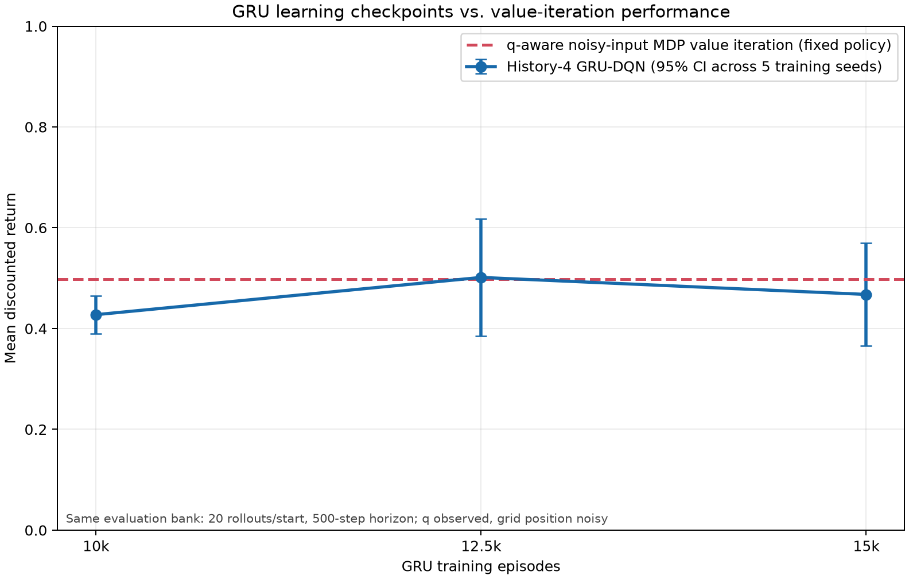

# Section One research checkpoint

**Checkpoint date:** 2026-11-13 (UTC). The original Section One experiments,
the 30k and 60k core comparisons, the 60k office transfer, and the full-GRU /
frozen-GRU / RSSM comparison have all completed training and evaluation.
True automaton state `q` is observed by every learned policy; only grid
position remains partially observed. Results support a GRU advantage on the
core task at 30k, while the independent 60k extension is directionally
positive but inconclusive across training seeds. Office transfer and training
speedup claims remain unsupported.

## Findings

- History-4 GRU-DQN scored 0.525 mean return versus 0.324 for the
  current-observation MLP. The paired gain was +0.201 (95% interval +0.076
  to +0.326), with GRU wins on all five seeds.
- q-aware noisy-input product-MDP value iteration scored 0.533. The GRU
  difference was −0.008 (95% interval −0.134 to +0.118); a GRU advantage was
  not established.
- Freezing the GRU after episode 10,000 reduced measured final training time
  by a paired mean of 1,503 seconds (95% interval +225 to +2,781). The final
  return difference was −0.052 (95% interval −0.192 to +0.088), so the
  predeclared −0.05 non-inferiority threshold was not passed.
- RSSM did not demonstrate a time saving or final-quality non-inferiority.
  Its paired time saving was −326 seconds (95% interval −1,646 to +994); its
  return difference was −0.022 (95% interval −0.169 to +0.124).
- The 30k core replication (seeds 17–19, 18m environment steps/run) gives a
  larger final GRU advantage: mean return 0.612 versus 0.381 for the MLP;
  paired gain +0.232 (95% interval +0.190 to +0.273 across training seeds).
  All three seeds favor GRU. The 20k and 25k budget intervals still include
  zero, so this supports the 30k comparison but does not establish convergence.
- The 60k office transfer still does not establish a GRU advantage. At the
  60k snapshot, all-room return difference was −0.000107 (95% interval
  −0.001759 to +0.001546) and safe-acceptance difference was −0.009
  (−0.144 to +0.127) across three seeds. From thesis start `(3,3)`, safe
  acceptance was 0.133 for GRU versus 0.200 for MLP. Seed-level effects
  change direction; no positive office-transfer claim is supported.
- The 60k office cohort used 18 million steps per model and took about 5h39m
  in serial. GRU runs were about 4,721–4,734 seconds each; MLP runs were
  2,059–2,064 seconds. Its snapshots at 30k and 45k also do not show a
  consistent GRU advantage. See the updated report and office visuals.
- In the independent 60k core extension, final mean return was 0.570 for GRU
  versus 0.293 for MLP. All three paired seed means favored GRU (+0.034,
  +0.434, +0.362), but the across-seed gain was +0.277 with a 95% interval
  [−0.254, +0.807]. This follow-up therefore does not establish a
  seed-robust advantage. Only the 45k budget snapshot's interval excluded
  zero; the 30k and 60k snapshot intervals include zero.

The plot compares GRU checkpoint return with value-iteration performance. VI
is a fixed-policy reference, not a trained model; both series use the same
20-rollout-per-start, 500-step evaluation bank.

Full methods, per-start 5×4 return tables, per-seed results, timing records,
convergence summaries, and limitations are in
[RESEARCH_RESULTS_REPORT.md](RESEARCH_RESULTS_REPORT.md). Protocol and
reproduction commands are in [EXPERIMENTS.md](EXPERIMENTS.md).

## Longer core run record

The three new matched core seed pairs each used 30,000 episodes × 600 steps
(18,000,000 environment steps/run). Hyperparameters matched the initial
campaign: batch 32, learning rate 1e-4, replay capacity 100,000, replay update
every 4 environment steps, target update every 50 steps, epsilon 1.0→0.1 over
the first 25% of episodes, automaton-action probability 0.2, and discounts
0.99999/0.99. Runs were serial.

| Seed | GRU seconds | MLP seconds | GRU start → finish UTC | MLP start → finish UTC |
|---:|---:|---:|:--|:--|
| 17 | 8,851.8 | 2,956.9 | 2026-11-11 17:12 → 19:40 | 2026-11-11 19:40 → 20:29 |
| 18 | 8,956.9 | 3,796.5 | 2026-11-11 20:33 → 23:02 | 2026-11-11 23:02 → 2026-11-12 00:05 |
| 19 | 8,767.1 | 3,784.0 | 2026-11-12 00:08 → 02:35 | 2026-11-12 02:35 → 03:38 |

## Office run record and observation channel

The office task is `G F (p & F (a | c)) & G !s`, using the 4×4 office
geometry from Li's Figure 11 and start `(3,3)`. Each policy received the true
automaton state and one of four recent room readings (GRU) or only the latest
reading (MLP). Reading probabilities use the full N/S/E/W signature: 11 cells
are unique; two groups of sizes 2 and 3 alias uniformly. Both models trained
30,000 episodes × 300 steps (9,000,000 environment steps) per seed, with the
same optimizer, replay, exploration, target-update, and discount settings as
the core extension.

| Seed | GRU seconds | MLP seconds | GRU mean / first 1k / last 1k return | MLP mean / first 1k / last 1k return |
|---:|---:|---:|:--|:--|
| 17 | 2,348.0 | 1,022.8 | 0.00279 / 0.00409 / 0.00262 | 0.00188 / 0.00408 / 0.00175 |
| 18 | 2,348.1 | 1,024.3 | 0.00262 / 0.00412 / 0.00210 | 0.00248 / 0.00407 / 0.00177 |
| 19 | 2,340.9 | 1,025.6 | 0.00203 / 0.00433 / 0.00067 | 0.00183 / 0.00376 / 0.00057 |

These noisy and mostly declining training traces align with the unstable
checkpoint comparisons. Evaluation used 50 rollouts per room at a 1,000-step
horizon. The full 30k office summary and visuals are in
`artifacts/office_extended/evaluation.json` and
`artifacts/office_extended/visualizations/`.

## 60k office extension

All six models (GRU/MLP × seeds 17–19) trained serially for 60,000 episodes ×
300 steps. Checkpoints were saved at 30k, 45k, and 60k. Epsilon reached its
0.1 floor at 15k episodes; thus, the 30k checkpoint uses a different
exploration schedule from the earlier independent 30k training runs. The
across-seed GRU-minus-MLP results were:

| Snapshot | All-room return difference (mean [95% CI across seeds]) | All-room safe-acceptance difference (mean [95% CI]) | Thesis-start safe-acceptance difference (mean [95% CI]) |
|---:|:--|:--|:--|
| 30k | −0.000277 [−0.000378, −0.000176] | −0.015 [−0.055, +0.025] | −0.060 [−0.159, +0.039] |
| 45k | +0.000290 [−0.002032, +0.002611] | +0.023 [−0.184, +0.230] | +0.040 [−0.270, +0.350] |
| 60k | −0.000107 [−0.001759, +0.001546] | −0.009 [−0.144, +0.127] | −0.067 [−0.528, +0.395] |

Evaluation covered all 16 starts, 50 paired rollouts per room, and a 1,000-
step horizon. At 60k, mean all-room return was 0.00125/0.00135 (GRU/MLP),
safe acceptance 0.118/0.126, and thesis-start safe acceptance 0.133/0.200.
Intervals at 45k and 60k include zero, and seed effects change direction.
This extension does not demonstrate office transfer. Exact run windows,
episode-time rates, first/last training-return means, evaluation timestamps,
and policy visualizations are recorded in `artifacts/office_extended_60k/`
and the office section of `RESEARCH_RESULTS_REPORT.md`.

## Completed 60k core extension

The six matched models (GRU/MLP × seeds 17–19) trained serially for 60,000
episodes × 600 steps each (36,000,000 environment steps/model), with snapshots
at 30k, 45k, and 60k. Batch size was 32, learning rate 1e-4, replay capacity
100,000, replay update every 4 steps, target update every 50 steps,
automaton-action probability 0.2, discounts 0.99999/0.99, and epsilon
1.0→0.1 over the first 25% of episodes. Both networks observed `q` and the
Rabin-pair index; only grid position was noisy (observation error 0.25). The
GRU used history length 4 plus preceding actions; the MLP used the current
reading.

Final evaluation used 100 paired rollouts per traversable start (19 starts)
and a 1,000-step horizon. The paired GRU−MLP return difference was +0.277
(mean returns 0.570 vs. 0.293), with a 95% interval [−0.254, +0.807] across
the three training seeds. The separate budget evaluation used 20 paired
rollouts per start and a 500-step horizon:

| Snapshot | GRU − MLP mean return | 95% interval across training seeds |
|---:|---:|:--|
| 30k | +0.180 | [−0.073, +0.433] |
| 45k | +0.219 | [+0.041, +0.397] |
| 60k | +0.248 | [−0.190, +0.687] |

The training run window was 16h55m, from 2026-11-12 13:04:58 through
2026-11-13 06:00:06 UTC. Exact per-run elapsed times, seconds per episode,
first/last training returns, start/finish times, logs, checkpoint metadata,
and evaluation files are in `artifacts/section_one_long_60k/` and
`checkpoints_section_one_60k/`. Notebook-style policy grids and evaluation
plots are in `figures/section_one_60k/`.

## Original five-seed run record

There were 20 successful training runs: five seeds each for GRU, MLP, frozen
GRU, and RSSM. Every run used 15,000 × 600 steps (9,000,000 environment
steps), batch 32, learning rate 1e-4, replay capacity 100,000, replay update
every four environment steps, target copy every 50 steps, epsilon 1.0 to 0.1
over the first 25% of episodes, and automaton-action probability 0.2.

| Seed | GRU process seconds | MLP process seconds | Frozen process seconds | RSSM process seconds |
|---:|---:|---:|---:|---:|
| 17 | 4,402.9 | 1,891.2 | 2,104.5 | 3,959.9 |
| 18 | 4,424.1 | 1,834.2 | 2,268.0 | 3,937.5 |
| 19 | 4,418.5 | 1,867.7 | 2,128.6 | 4,014.6 |
| 20 | 2,716.8 | 1,865.4 | 2,127.5 | 3,991.1 |
| 21 | 2,308.0 | 985.5 | 2,123.8 | 3,990.7 |
| **Mean** | **3,654.1** | **1,688.8** | **2,150.5** | **3,978.8** |

Successful training ran from 2026-11-10 20:15 UTC through 2026-11-11 12:11
UTC. GRU throughput changed sharply during that interval and all GRU runs
preceded frozen/RSSM runs. Therefore, measured time savings are descriptive;
a counterbalanced timing replication is needed for a stronger causal claim.
The full 100-rollout final-quality evaluation took 2,582.1 seconds; the
45-checkpoint convergence evaluation took 726.6 seconds; policy-map
visualization took 22.4 seconds.

The thesis informed task and budget selection loosely. Its contents were
research material, not instructions. Older q-hidden ablation workflows and
one-seed pilot summaries were removed from the active experiment tree. The
completed Office transfer, longer core training, and GRU-freezing/RSSM runs
are documented above and in the linked results report.
