# 60k core GRU and MLP visualizations

All empirical return maps use the existing notebook-style `GridMDP.plot` renderer. The numerical values and task labels remain in `artifacts/section_one_long_60k/visualizations/state_grids/state_value_grids.json`.

## Training and evaluation

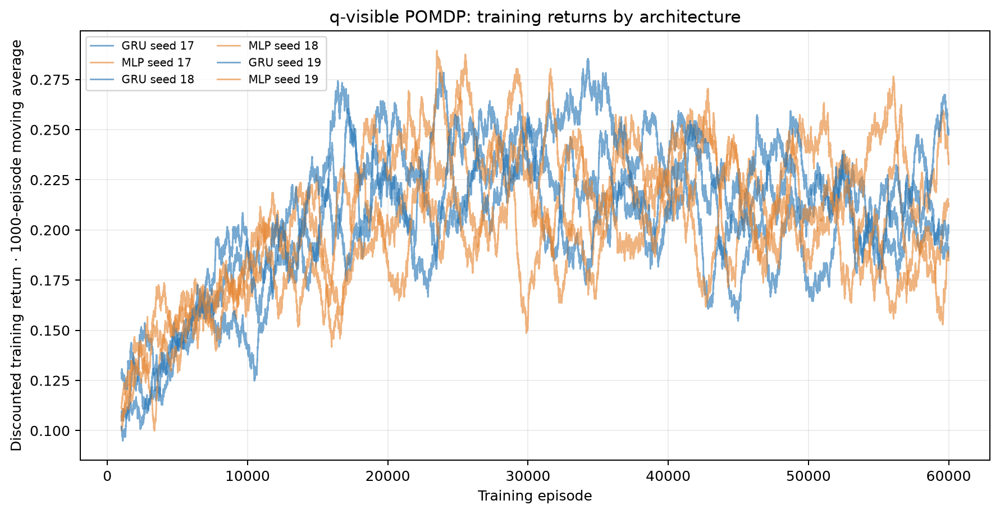

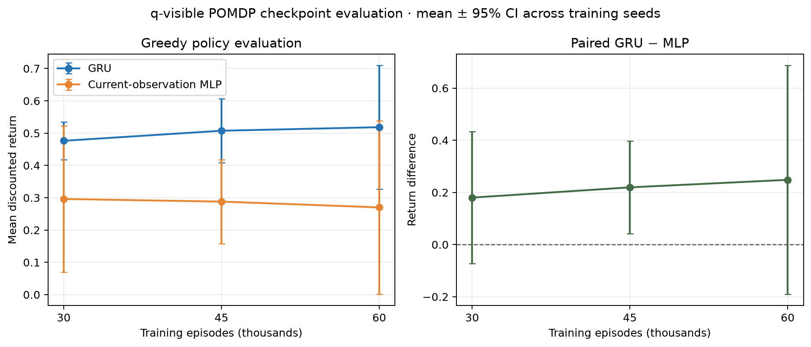

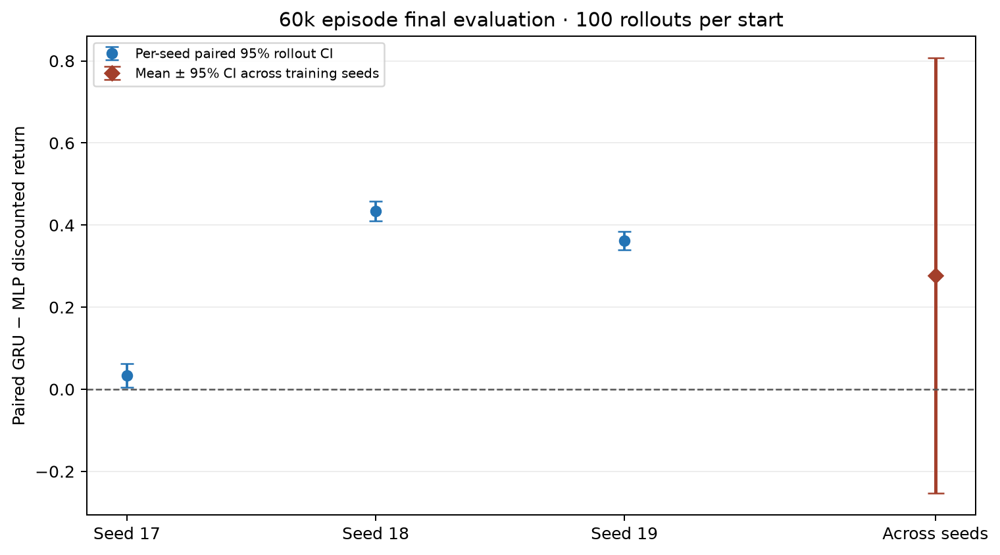

## Aggregate empirical return maps

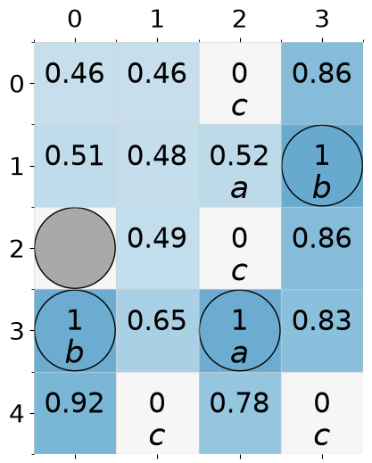

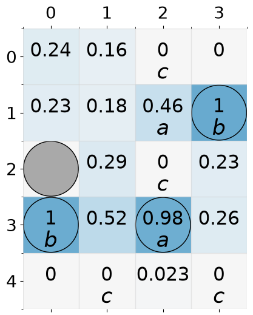

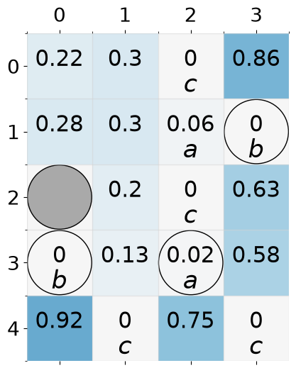

## Per-seed maps

### Seed 17

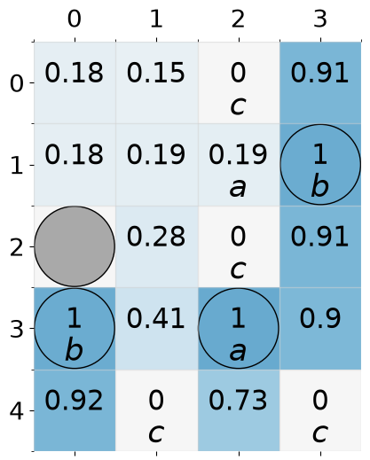

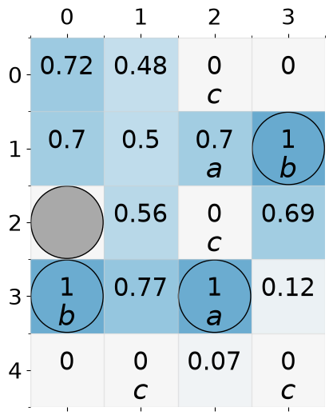

### Seed 18

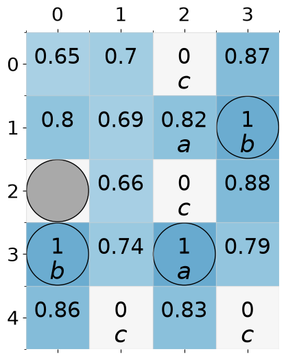

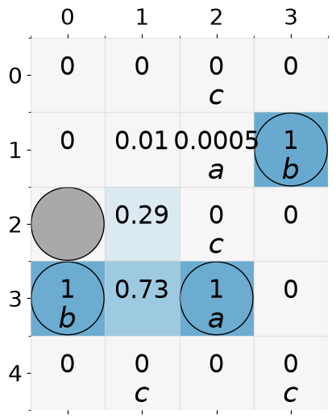

### Seed 19

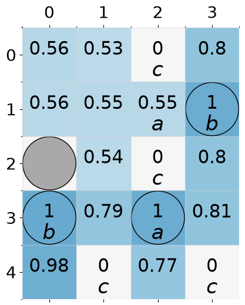

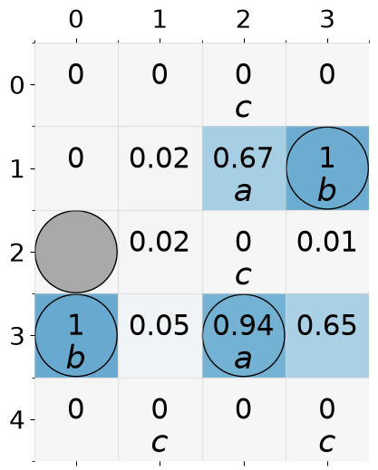
